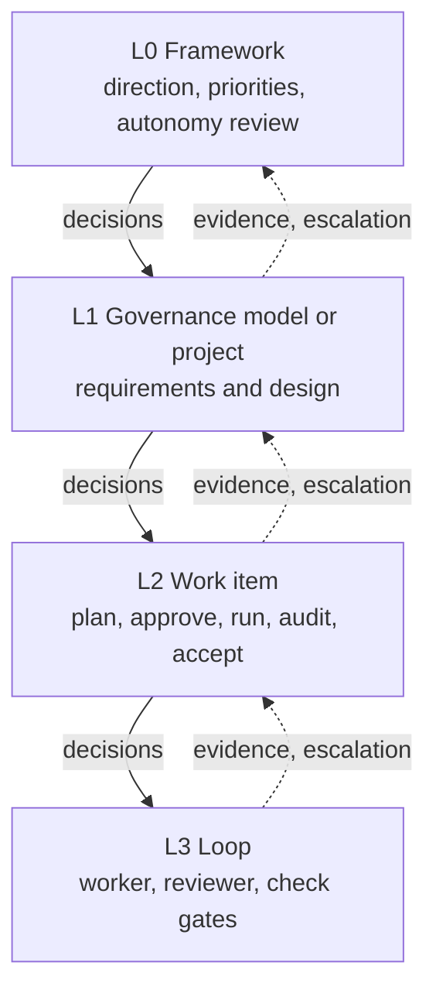
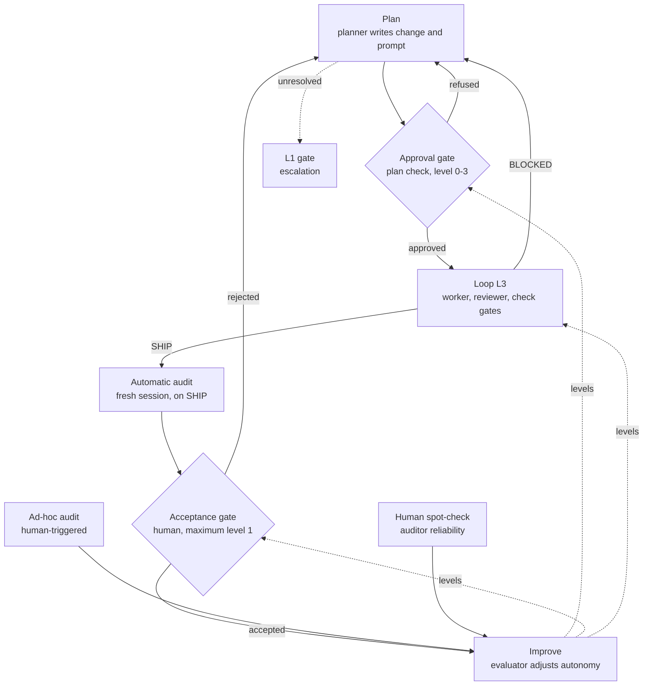

# Recursive Governance Cycle and Graduated Autonomy

Created: 2026 November 06

**UUID:** `63c98596`
**Status:** Concept, v0.2. This document changes no governance document, template, manifest, configuration, engine code or requirement.
**Related:** [design-14e05e35-engine-generalisation.md](design-14e05e35-engine-generalisation.md), governance.md P02 and P13.3, requirements-14e05e35 FR-03-05 and FR-08-04.

---

## Table of Contents

- [1.0 Purpose and Scope](#10-purpose-and-scope)
- [2.0 Background](#20-background)
- [3.0 Cycle Model](#30-cycle-model)
- [4.0 Levels](#40-levels)
- [5.0 Approval Gates and Autonomy](#50-approval-gates-and-autonomy)
- [6.0 Delegated Approval](#60-delegated-approval)
- [7.0 Audit](#70-audit)
- [8.0 Autonomy Evaluation](#80-autonomy-evaluation)
- [9.0 Workflow](#90-workflow)
- [10.0 Impact on Existing Framework](#100-impact-on-existing-framework)
- [11.0 Decisions](#110-decisions)
- [12.0 Open Questions](#120-open-questions)
- [13.0 Glossary](#130-glossary)
- [References](#references)
- [Version History](#version-history)

---

## 1.0 Purpose and Scope

### 1.1 Purpose

This document describes a concept for how AI-G&O evolves and governs work:

- one cycle, Plan → Do → Check → Improve, repeated at four nested levels;
- approval gates between stages, where a human or a delegated model decides;
- autonomy per approval gate that is raised or lowered on audit evidence.

### 1.2 In Scope

- The cycle unit, its levels, and the flow of decisions and evidence between levels.
- Approval gates, autonomy levels, ceilings and human override.
- Delegated approval by the audit component.
- The automatic audit, the ad-hoc audit and the autonomy evaluator.
- The impact on existing governance, templates, configuration and requirements, listed but not changed.

### 1.3 Out of Scope

- Changes to governance.md, templates, manifests, `ai/config.yaml`, engine code or requirements.
- Implementation design and code.
- Higher-level cycles (L0–L2) running inside the engine (D2).
- Multi-user operation and organisational compliance.

### 1.4 Status

This is a concept. Implementation requires amended requirements, a design, and issue → change → prompt triples per governance.

[Return to Table of Contents](#table-of-contents)

---

## 2.0 Background

### 2.1 Existing Mechanisms

| Mechanism | Description | Source |
|---|---|---|
| Loop | Worker → reviewer → check gates until SHIP or BLOCKED | governance P00.11 |
| Stage tracking | Manifest stages declare `owner` and `approval`; BLOCKED names a return stage | design-14e05e35 §6.0, §8.0 |
| Approvals | `approve.py` records human approvals in `ai/approvals.yaml`, tied to document blob hashes | design-14e05e35 §8.2 |
| Audit | Strategic (planner) and tactical (engine audit loop) modes; T08 report | governance P02.4, P02.9 |
| Improvement | Quality baseline, audit history, non-conformance trends, lessons learned, knowledge base | governance P02.1, P02.7, P03.5, P03.6, P00.16 |

### 2.2 Gaps

- The improvement elements are optional and have no trigger, no output and no path back into governance.
- Audit results do not influence how much work is delegated to models.
- Approval is binary and human only; the approver's identity is not recorded or checked (DI-03).

### 2.3 Precedent

- The Plan-Do-Check-Act cycle (Shewhart, 1939; Deming, 1986).
- The spiral model, where each cycle ends with a review and commitment decision (Boehm, 1988).
- Stage-Gate decisions to go, kill, hold or recycle (Cooper, 1990).
- Recursive levels in the Viable System Model (Beer, 1972).

[Return to Table of Contents](#table-of-contents)

---

## 3.0 Cycle Model

### 3.1 Cycle Unit

| Stage | Purpose |
|---|---|
| Plan | Define the outcome and the work of the next lower level |
| Do | Execute the work, which consists of cycles at the next lower level |
| Check | Verify the output against the plan |
| Improve | Adjust governance and autonomy from the evidence |

Check verifies the output. Improve changes how the work is done. The two are kept separate so that process improvement has its own stage (D19).

### 3.2 Gates

- Each cycle has an entry gate (approve the plan) and an exit gate (accept the outcome).
- Gate decisions: proceed, revise, return to a stage, stop, redirect.
- Redirect, the decision on the focus of future effort, belongs to the L0 and L1 gates.

### 3.3 Direction of Flow

- Decisions flow down. Evidence and escalations flow up.
- Findings at a lower level may revise the plan of the level above. A purely top-down drill-down is not intended.

### 3.4 Recursion

- The Do stage of level n consists of cycles at level n+1. L3, the loop, is the base case.
- Within each level, stage flow remains linear plus one rule: if blocked, return to stage X.

### 3.5 Escalation

BLOCKED is generalised: a problem that cannot be resolved at a level is passed to the gate of the parent level.

[Return to Table of Contents](#table-of-contents)

---

## 4.0 Levels

### 4.1 Level Definitions

| Level | Cycle | Plan produces | Do consists of | Executed by | Existing artefacts |
|---|---|---|---|---|---|
| L0 Framework | Direction and priorities | Focus of future effort | L1 cycles | Human, planner | `dev/task.md`, brainstorms |
| L1 Governance model or project | Requirements and design | Work items | L2 cycles | Human, planner | Requirements, design (P11, P12) |
| L2 Work item | Issue → change → prompt | T03 prompt | L3 loop | Planner, engine (plan check, loop, audit) | Triple, T08, `ai/approvals.yaml` |
| L3 Loop | Worker → reviewer → check gates | — | One iteration | Engine | State directory, `run.json` |

The number of levels is a starting point and may be revised (D1).

### 4.2 Level Diagram

[Return to Table of Contents](#table-of-contents)

---

## 5.0 Approval Gates and Autonomy

### 5.1 Terminology

The engine already uses "gate" for in-loop checks (syntax, command, reviewer). This concept uses "approval gate" for decision points between stages. In-loop checks are called "check gates" here.

### 5.2 Autonomy Levels

| Level | Decision | Waiting |
|---|---|---|
| 0 | A human decides | Waits for the human |
| 1 | A model recommends with reasoning; a human decides | Waits for the human |
| 2 | A model decides; the human is notified and may veto | Proceeds after a veto window |
| 3 | A model decides; quality is checked by audits | Proceeds immediately |

The waiting behaviour follows from the level. No separate confidence measure is used (D23).

### 5.3 Configuration

- The governance model's manifest sets the maximum level (ceiling) per approval gate.
- The project's `ai/config.yaml` sets the current level, which cannot exceed the ceiling.
- The evidence window N, thresholds and the veto window are configuration settings with defaults (D9, D23).

### 5.4 Ceilings

- Ceiling 0: governance changes, irreversible actions, L0 direction (D5).
- Acceptance of a work item: ceiling 1. Level 2 is to be reconsidered at an L0 Improve review once audit evidence supports it (D22).

### 5.5 Human Override

A human may change any approval gate's level at any time, in either direction (D3).

### 5.6 Enforcement

Autonomy levels are enforced by the orchestrator, not by instructions to models. Every level change is recorded.

[Return to Table of Contents](#table-of-contents)

---

## 6.0 Delegated Approval

### 6.1 Approver

Delegated approval is performed by the audit component in plan-check mode, never by the planner that wrote the documents (D20).

### 6.2 Inputs

The plan documents of the stage and the documents they build on (issue, requirements, design baseline). Which documents apply is declared per governance model in the manifest.

### 6.3 Behaviour by Level

| Level | Behaviour |
|---|---|
| 0 | The engine refuses the run until a human records the approval with `approve.py` (current behaviour) |
| 1 | The approver writes a recommendation with reasoning; the engine refuses the run until a human records the approval |
| 2 | The approver records the approval through `approve.py` with its own identity; the run starts after the veto window |
| 3 | The approver records the approval; the run starts immediately |

### 6.4 Approval Record

- Each entry in `ai/approvals.yaml` gains an `approver` field (`human` or `<role>:<model-id>`) and a reasoning field for delegated approvals.
- Existing entries without `approver` are treated as human.
- Only `approve.py` writes `ai/approvals.yaml`. The engine invokes it for model approvals; it does not write the file directly.

### 6.5 Independence

- The approver's model differs from the planner's model.
- The planner runs outside the engine, so its model is declared in configuration for this validation.

### 6.6 Failure

If the approver cannot run, no approval is given and the gate falls back to the human.

### 6.7 Accepted Risk

- The `approver` field of human approvals is declared, not enforced. DI-03 is extended to delegated approval (D21).
- Model approvals are written by the engine with the approver's identity, so a model approval cannot be recorded as human through this path.
- Signed commits for human approvals remain a possible later upgrade (OQ-07).

### 6.8 Residual Risk

The same model may approve a plan and later audit its implementation, and may miss the same defects twice. Mitigations: human spot-checks (D10), ad-hoc audits (D17), and optionally different model bindings for plan check and audit.

[Return to Table of Contents](#table-of-contents)

---

## 7.0 Audit

### 7.1 Automatic Audit

- The engine triggers an audit when a loop ends with SHIP. No audit is triggered on BLOCKED (D11).
- The audit runs in a fresh, read-only session. It receives the T03 prompt, the approved design baseline and the diff, not the worker's or reviewer's conversation.
- Scope is the change made in the loop.
- The automatic audit replaces the independent-session audit currently required before closure of a work item (D14).

### 7.2 Auditor

- Audit is a component of the existing engine, not a separate engine (D7).
- The auditor is a more capable model, preferably a frontier model (D12).
- The auditor's model differs from the worker's and the reviewer's, preferably from another model family. Configuration validation enforces this.
- If the worker is a frontier model, the auditor is a different provider or family of at least equal capability.
- Anthropic and Mistral have equal weight as auditor providers.

### 7.3 Fallback Auditor

- An open-weight auditor may be used as a fallback.
- Its audits can demote but cannot promote. It may recommend promotion to the human, with reasoning (D13).

### 7.4 Failure

If the auditor cannot run, the result is marked unaudited. The work item cannot close, no promotion occurs, and the human is notified.

### 7.5 Audit Report

The T08 report gains:

- an autonomy recommendation with reasoning, completed by every auditor (D16);
- an origin per finding: `plan`, `implementation` or `unknown`, set by the auditor and correctable by the human at audit closure (D24);
- the auditor class (preferred or fallback).

### 7.6 Ad-hoc Audit

- The strategic audit becomes an ad-hoc audit, triggered by the human at any time (D14).
- It is performed by the planner or, optionally, by the tactical audit loop (D18).
- Its findings count as evidence for autonomy. They do not count as spot-checks of the auditor (D17).

### 7.7 Auditor Reliability

Human spot-checks of audits are the evidence for the auditor's own reliability (D10).

[Return to Table of Contents](#table-of-contents)

---

## 8.0 Autonomy Evaluation

### 8.1 Evaluator

Autonomy levels are adjusted by deterministic code. No language model decides an autonomy level (D7).

### 8.2 Trigger

Each completed audit triggers one atomic evaluation: evaluate, adjust by at most one level, record (D6).

### 8.3 Evidence

- The evaluator reads the last N audit records for the gate, not only the current one.
- The measure is a severity-weighted finding rate per audited unit.
- A minimum number of audits is required before any promotion.
- Counted: automatic audits and ad-hoc audits.
- Not counted: loop reviewer verdicts (D8) and the autonomy recommendation field, which is advisory.

### 8.4 Attribution

| Finding origin | Counts against |
|---|---|
| `plan` | The approval gate of the stage that approved the plan |
| `implementation` | The loop's gates |
| `unknown` | Both |

### 8.5 Demotion

- Applied when the audit report is complete, without waiting for audit closure.
- One level for a rising finding rate. To level 0 on any critical finding.
- Automatic and reported to the human (D4).

### 8.6 Promotion

- Considered only after audit closure (P02.8).
- Proposed by the evaluator when audits by the preferred auditor meet the threshold. Confirmed by the human (D4).
- Audits by a fallback auditor do not count towards promotion. Their recommendations are shown to the human, labelled by auditor class, next to the finding history.

### 8.7 Reset

When the model bound to a gate changes, the gate returns to its configured default level.

### 8.8 Idempotence

Evaluation records are keyed by audit UUID. Repeating an evaluation does not count an audit twice.

### 8.9 Audit Frequency

Audits continue at every autonomy level. The automatic audit runs on every SHIP.

### 8.10 Record and Review

Every level change is recorded with its evidence and reviewed at the L0 Improve stage.

[Return to Table of Contents](#table-of-contents)

---

## 9.0 Workflow

### 9.1 Work Item Workflow (L2)

### 9.2 Notes

- The dashed `levels` paths are demotions (automatic) and promotion proposals (human-confirmed).
- Human spot-checks inform the auditor's reliability at the L0 Improve review; they do not adjust gate levels directly.
- Escalation applies at every level; only the L2 → L1 path is shown.

[Return to Table of Contents](#table-of-contents)

---

## 10.0 Impact on Existing Framework

### 10.1 Required Changes

The following would change on implementation. Nothing is changed by this document.

| Item | Current | Required change |
|---|---|---|
| governance P02.2 | Milestone, human-requested and baseline triggers | Add automatic trigger on SHIP; human trigger becomes ad-hoc audit |
| governance P02.9 | Strategic and tactical modes | Automatic audit; ad-hoc audit by planner or tactical audit loop |
| governance P02.8.2 | Independent-session audit before closure | Replaced by the automatic audit |
| governance P00.9, P13.3 | Human approval required | Per-gate autonomy level, ceilings |
| T08 template | Findings, severity, mode | Autonomy recommendation, finding origin, auditor class |
| `manifest.yaml` | `approval: true\|false` per stage | Autonomy ceiling per stage; plan-check inputs per stage |
| `ai/config.yaml` | Role bindings, gates | Current levels, N, thresholds, veto window, auditor and approver bindings, declared planner model |
| `ai/approvals.yaml` | uuid, stage, date, blobs | `approver`, reasoning |
| FR-03-05 | The engine never passes a human approval | Allow approval gates above level 0 |
| FR-08-04 | No engine path writes `ai/approvals.yaml` | Allow the audit component to record approvals through `approve.py` |
| DI-03 | Planner with shell access can commit an approval; accepted | Extended to delegated approval (D21) |
| Autonomy record | None | New record of levels and evaluations (OQ-03) |

### 10.2 Transferred Register Items

The following items were removed from `dev/task.md` on 2026-11-06, or not registered there (2026-11-07), because this concept reshapes them. They are resolved in the requirements and design that implement it.

| Item | Source | Reason for transfer |
|---|---|---|
| `approve.py` accepts an `accept` approval before any loop run | audit-14e05e35 L-14 | Acceptance follows the automatic audit (§9.1, D22), not loop completion |
| Stage scan does not report a completed status in an active folder after closure | audit-14e05e35 L-11 | Manifest `approval` becomes a per-stage ceiling (§10.1) |
| Duplicated parsing and layout logic across engine and webui; consolidate in `ai/core/` | audit-caab2052 L-17 | The audit component and the evaluator (D7) set the module boundaries |
| Very large functions (`run_phase`, `run_loop`); project root implied by the working directory | audit-caab2052 L-18 | As L-17 |
| Reserved protocols P05 Continuous Integration, P16 Execution, P17 Release, P18 Deployment and Propagation, P19 Observability | proposal-eb782f83 §5.3 | Authored with the P02, P00.9 and P13.3 amendments; P19 relates to the autonomy record (OQ-03) |
| `.github/workflows` CI running `linter.py`, `protocol_checker.py`, pytest and the primer identity check | gap G1; decision 7.1 | Governed by P05 |
| Tests for `bin/migrate-layout.sh` and `bin/propagate.sh` end to end | audit-5bcd46ad L-08 | Run under P05 CI |
| Phase 3: second governance model (document authoring) under `ai/governance/<name>/` | proposal-5bcd46ad; requirements-14e05e35 out-of-scope table | Tests per-model ceilings and plan-check inputs (§5.3, §6.2) |
| The CLI (`orchestrator._work_item_uuid`) and engine-mcp (`_PROMPT_NAME`) take the work-item UUID only from a `prompt-<uuid>-` name; with a manifest whose task stage has another prefix, every tracked CLI task is refused with `work item : no documents found`. Derive the UUID from the manifest's task stage | audit-4b0a5592 F-03 | Only arises with a second governance model (Phase 3, above) |
| Evaluate splitting `governance.md` | proposal-5bcd46ad OQ-03 | Implementation amends governance.md |
| Phase 4: central web GUI; `ai/webui/` is its component | proposal-5bcd46ad; report-14cf601f | Provides the human interface for veto windows, promotion confirmation and notifications (D4, D23) |
| Project Overwatch FR-02 to FR-10; design-project-overwatch OQ-07 open by design | design-project-overwatch §9.2; proposal-5bcd46ad D-12 | Reconsidered within Phase 4 |

Note: the native Anthropic provider has not been verified against the Anthropic API (requirements-14e05e35 V-04), and no API key is planned. Until it is verified, a Mistral model is the only frontier auditor that can be tested live. D12 and §7.2 are unchanged.

[Return to Table of Contents](#table-of-contents)

---

## 11.0 Decisions

| # | Decision |
|---|---|
| D1 | Four levels: L0 framework, L1 governance model or project, L2 work item, L3 loop; revisable later |
| D2 | Higher-level cycles running inside the engine are parked for a later discussion |
| D3 | Autonomy is set per approval gate, levels 0–3; a human may override at any time |
| D4 | Promotion is proposed by the system and confirmed by the human; demotion is automatic and reported |
| D5 | Ceiling-0 gates: governance changes, irreversible actions, L0 direction |
| D6 | Autonomy is adjusted atomically after each audit, by at most one level, from the last N audit records |
| D7 | Audit is a component of the existing engine; a deterministic evaluator decides autonomy levels |
| D8 | Only independent audits count as evidence; loop reviewer verdicts do not |
| D9 | N and thresholds are configuration settings with defaults |
| D10 | Human spot-checks of audits are the evidence for the auditor's reliability |
| D11 | The engine triggers an automatic audit in a fresh session when a loop ends with SHIP, and only then |
| D12 | The auditor is a more capable model, preferably frontier, and differs from the worker and reviewer |
| D13 | Fallback auditor audits can demote but not promote; they may recommend promotion with reasoning |
| D14 | The automatic audit replaces the strategic audit before closure; the strategic audit becomes an ad-hoc audit triggered by the human at any time |
| D15 | This concept document is held in `dev/design/` |
| D16 | Every T08 report carries an autonomy recommendation with reasoning |
| D17 | Ad-hoc audits count as evidence for autonomy, not as auditor spot-checks |
| D18 | The tactical audit loop is an optional way of running an ad-hoc audit |
| D19 | The cycle stages are Plan → Do → Check → Improve |
| D20 | Delegated approval is performed by the audit component in plan-check mode, never by the planner |
| D21 | The `approver` field is declared, not enforced, for human approvals; DI-03 is extended |
| D22 | Acceptance of a work item has a ceiling of level 1; level 2 to be reconsidered with evidence |
| D23 | Waiting follows the level: 1 waits for the human, 2 proceeds after a veto window, 3 proceeds immediately; the window is configured |
| D24 | T08 findings carry an origin (`plan`, `implementation`, `unknown`); `unknown` counts against both gates |

[Return to Table of Contents](#table-of-contents)

---

## 12.0 Open Questions

| # | Question |
|---|---|
| OQ-01 | Whether, and how, higher-level cycles could run inside the engine (D2) |
| OQ-02 | Default values for N, thresholds, severity weights, minimum audit count and the veto window |
| OQ-03 | Format and location of the autonomy record (levels, evaluations, evidence) |
| OQ-04 | How the auditor class (preferred or fallback) is declared and validated |
| OQ-05 | Monitoring of audit and plan-check cost per work item |
| OQ-06 | Initial ceilings per stage in the software-engineering manifest |
| OQ-07 | Signed commits for human approvals as a later upgrade to D21 |
| OQ-08 | How L0 and L1 cycles are recorded, for example `dev/task.md` as the L0 register |
| OQ-09 | How a rejected acceptance interacts with the iteration rules (P00.10) |

[Return to Table of Contents](#table-of-contents)

---

## 13.0 Glossary

| Term | Meaning |
|---|---|
| Approval gate | A decision point between stages, decided by a human or a delegated model |
| Autonomy level | The degree of model decision at an approval gate, 0–3 |
| Ceiling | The maximum autonomy level of an approval gate, set by the governance model |
| Check gate | An in-loop engine check: syntax, command or reviewer |
| Cycle | Plan → Do → Check → Improve at one level |
| Evaluator | Deterministic code that adjusts autonomy levels from audit records |
| Automatic audit | The audit the engine triggers after SHIP |
| Ad-hoc audit | An audit triggered by the human at any time |
| Plan check | The audit component's review of plan documents, used for delegated approval |
| Auditor class | Preferred (more capable, preferably frontier) or fallback (open-weight) |
| Veto window | The period after a level-2 decision during which the human may veto |

[Return to Table of Contents](#table-of-contents)

---

## References

BEER, Stafford, 1972. *Brain of the Firm*. London: Allen Lane.

BOEHM, Barry W., 1988. A spiral model of software development and enhancement. *Computer*. Vol. 21, no. 5, pp. 61–72. DOI 10.1109/2.59.

COOPER, Robert G., 1990. Stage-gate systems: a new tool for managing new products. *Business Horizons*. Vol. 33, no. 3, pp. 44–54.

DEMING, W. Edwards, 1986. *Out of the Crisis*. Cambridge, MA: MIT Center for Advanced Engineering Study.

SHEWHART, Walter A., 1939. *Statistical Method from the Viewpoint of Quality Control*. Washington, DC: Graduate School of the Department of Agriculture.

[Return to Table of Contents](#table-of-contents)

---

## Version History

| Version | Date | Changes |
|---|---|---|
| 0.1 | 2026-11-06 | Initial concept: cycle model, levels, approval gates and autonomy, delegated approval, audit, autonomy evaluation, workflow, impact, decisions D1–D24, open questions |
| 0.2 | 2026-11-06 | §10.0 split into §10.1 Required Changes and §10.2 Transferred Register Items (eleven items from nine `dev/task.md` rows; Anthropic provider note) |
| 0.3 | 2026-11-07 | §10.2: task-stage prefix item (audit-4b0a5592 F-03) |

---

Copyright (c) 2026 William Watson. MIT License.
